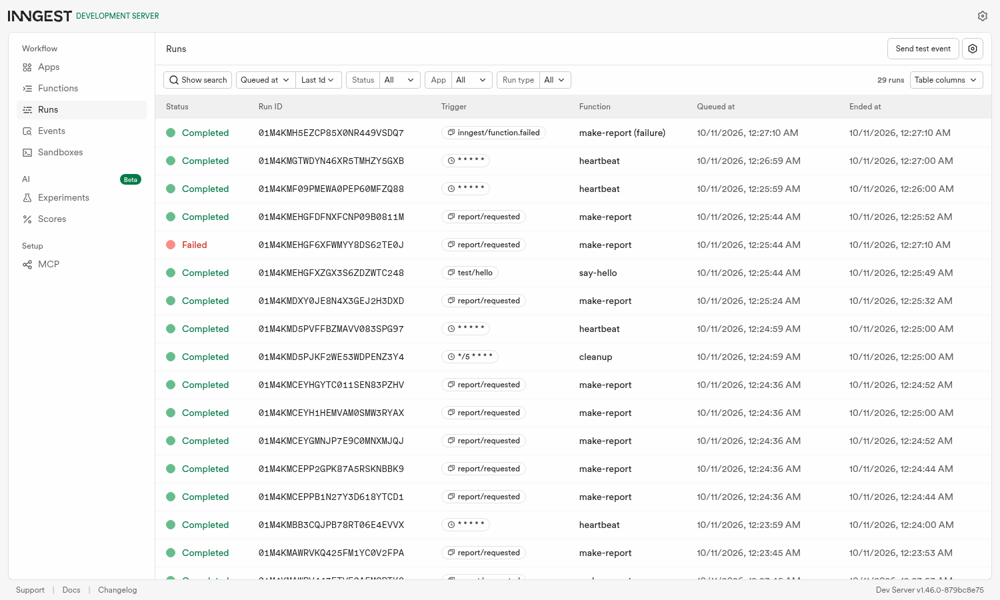
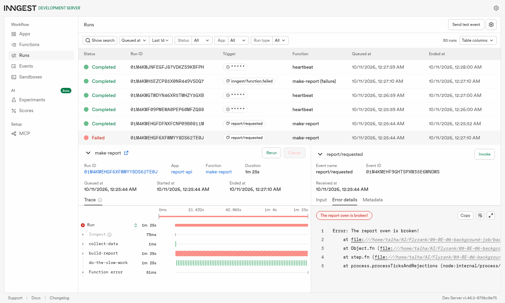
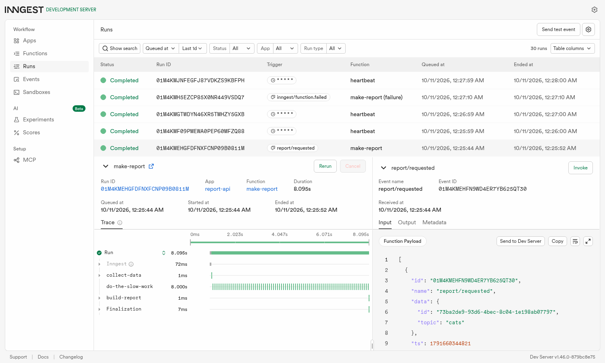
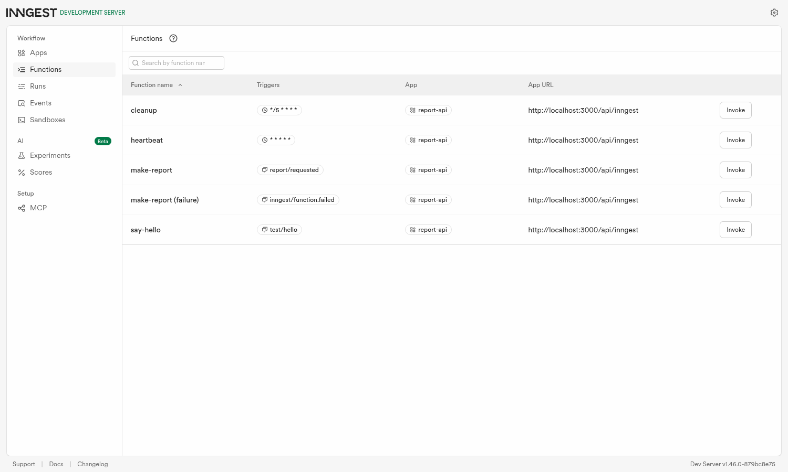

# background-job-api

A small Express API whose slow work happens in a **background job**. `POST /reports` answers `202` in milliseconds, an
[Inngest](https://www.inngest.com) function builds the report ~8 seconds later, and `GET /reports/:id` tells the client when it is
ready. A second function runs on a **cron** schedule with no request at all.

FlyRank Backend track, Week 4, assignment A7 (JavaScript lane: Express + Inngest).

## Run it (two terminals)

Needs Node 22+. No account, no card, nothing to configure.

```bash
npm install
npm start          # terminal 1: API on http://localhost:3000
npm run inngest    # terminal 2: Inngest Dev Server + dashboard on http://localhost:8288
```

`npm run inngest` is `npx inngest-cli@latest dev -u http://localhost:3000/api/inngest --no-discovery`. Then:

```bash
curl -i -X POST localhost:3000/reports -H "Content-Type: application/json" -d '{"topic":"cats"}'
curl localhost:3000/reports/<id>        # pending ... then, ~8 s later, done
```

`npm test` runs the API tests (4 tests, no Inngest needed: the job system is replaced by a fake `send`).

## Endpoints and functions

| Endpoint | What it does |
|---|---|
| `GET /health` | `{ "status": "ok" }` |
| `POST /reports` `{ "topic": "cats" }` | validates, stores `pending`, sends the `report/requested` event, answers **202** `{ id, status }`. Missing/empty/non-string topic: **400**, no event |
| `GET /reports/:id` | the saved report: `pending`, later `done` + `result` (or `failed` + `error`). Unknown id: **404** |
| `GET /reports` | every report and its status (extra) |
| `/api/inngest` | where the Dev Server calls my functions (Inngest `serve`) |

| Function | Trigger | What it does |
|---|---|---|
| `say-hello` | event `test/hello` | `step.sleep` 5 s, returns "Hello from the background!" (Stage 1) |
| `make-report` | event `report/requested` | steps `collect-data` → `do-the-slow-work` (`step.sleep` 8 s) → `build-report`; 3 attempts (`retries: 2`); topic `"fail"` throws "The report oven is broken!"; `onFailure` marks the report `failed` |
| `heartbeat` | cron `* * * * *` | logs `heartbeat: N pending, N done, N failed` |
| `cleanup` | cron `*/5 * * * *` | deletes `done` reports older than 10 minutes (extra) |

## Proof: 202 now, done later

Real output from my machine (`time` on the POST):

```
$ time curl -si -X POST localhost:3000/reports -H "Content-Type: application/json" -d '{"topic":"cats"}'
HTTP/1.1 202 Accepted
{"id":"3581f8da-e6f8-4495-be5f-a4076bdaa3f7","status":"pending"}
real    0m0.017s

$ curl localhost:3000/reports/3581f8da-e6f8-4495-be5f-a4076bdaa3f7        # right away
{"id":"3581f8da-...","topic":"cats","status":"pending"}

$ curl localhost:3000/reports/3581f8da-e6f8-4495-be5f-a4076bdaa3f7        # 12 seconds later
{"id":"3581f8da-...","topic":"cats","status":"done","result":{"title":"Report on cats","summary":"Everything we know about cats, compiled in the background.","builtAt":"2026-10-10T19:17:59.536Z"}}

$ curl -o /dev/null -w "%{http_code}" localhost:3000/reports/nope
404
```

The request took 17 ms; the work took 8 s. The first answer is `pending`, the later one `done`: that is eventual consistency.

## Dashboard



The runs list shows all the functions: completed `make-report` runs, one `Failed` run, `heartbeat` every minute at `:59`, and
`cleanup` every 5 minutes. The failed run (the `"fail"` topic) below took 1 m 25 s because the waits between attempts grow
(backoff). Its trace shows `collect-data` done once, then `build-report` failing:






Attempt count, read from the Dev Server's API for that failed run: the `build-report` spans carry `attempts` 0, 1 and 2, so
**3 attempts**, then the run is `Failed`. A request with no topic never creates a run at all.

## Stage 3 sentence: retry vs. reject

A request with a missing topic is wrong *forever*, so it is rejected at the door with a 400 and never becomes a job (retrying
it would just fail three more times); a job that fails because the oven hiccuped is wrong only *for now*, so it deserves a retry
after a wait.

## Stage 4 sentences: cron

- Every day at 08:00: `0 8 * * *`
- Every Sunday at 22:00: `0 22 * * 0` (`0` or `7` both mean Sunday)

Heartbeat proof from the API log, one line per minute:

```
heartbeat: 0 pending, 1 done, 0 failed
heartbeat: 0 pending, 1 done, 0 failed
```

## Extras I built

- **List endpoint** `GET /reports`.
- **Outbox**: `build-report` also writes `outbox/<id>.txt`, a stand-in for sending an email from a job.
- **Cleanup cron** (`cleanup`, every 5 min).
- **Idempotency**: `make-report` has `idempotency: "event.data.id"` and `build-report` checks `status === "done"`. I fired
  `report/requested` twice with the same id straight at the Dev Server (`curl localhost:8288/e/test ...`) while 5 reports
  were running: the log showed exactly 5 `build-report executed` and 5 `collect-data executed` lines, not 6. Why jobs must
  survive running twice: queues deliver *at least once*, and a retry after a crash can re-run a step that had in fact
  succeeded, so running twice must cost the same as running once.
- **Concurrency limit of 2** (`concurrency: 2`). **Finding:** with `step.sleep` as the slow work, all 5 reports finished at
  the same time, the limit did nothing. Inngest counts steps that are *executing*, and a run that is sleeping holds no slot. So
  I added `SLOW_AS_STEP=1`, which makes the slow work a `step.run` that really occupies the worker (like an AI call). Then
  5 reports finished as `done=0 → 2 → 4 → 5`, in waves of 2 about 8 seconds apart, with the others waiting in line
  (`SLOW_AS_STEP=1 npm start`). When would you want a queue to be slow? When the service behind it is the fragile part
  (an AI API with a rate limit, a mail provider), where waiting is cheaper than being blocked.
- **Restart experiment (durable)**: I started a report, killed the API 3 s in (inside the 8 s sleep), waited 3 s, and started
  it again, so its memory was empty. The log:

  ```
  API on http://localhost:3000
  collect-data executed for c4e5a843-...        <- step 1, before the kill
  API on http://localhost:3000                  <- restarted
  build-report executed for c4e5a843-...        <- step 3, after the restart
  ```

  `collect-data` ran once, not twice: Inngest had saved that finished step, kept the clock running while my server was down, and
  called the restarted server to finish the job (the report came back `done`). The job survived; the server did not have to.
  `build-report` therefore *upserts* the report instead of assuming it is still in memory.

## What this is not

- The report store is an in-memory `Map`, so it forgets everything on restart (`done` reports survive only because the
  restart experiment rebuilds them). Same lesson as the CRUD API; a database would fix it.
- Runs against the local **Dev Server** only (`isDev` when `NODE_ENV` is not `production`). Deploying would need
  `INNGEST_EVENT_KEY` / `INNGEST_SIGNING_KEY`; I did not test that.
- `heartbeat` runs every minute on purpose, for testing; a real one would be daily.
- Skipped: the AI rematch bonus stage.

## Layout

```
src/app.js      Express app (createApp({ send, reports }))
src/server.js   wires the app to Inngest and listens
src/inngest.js  the client and the four functions
src/store.js    the in-memory Map
test/           node:test API tests
docs/           dashboard screenshots
```
